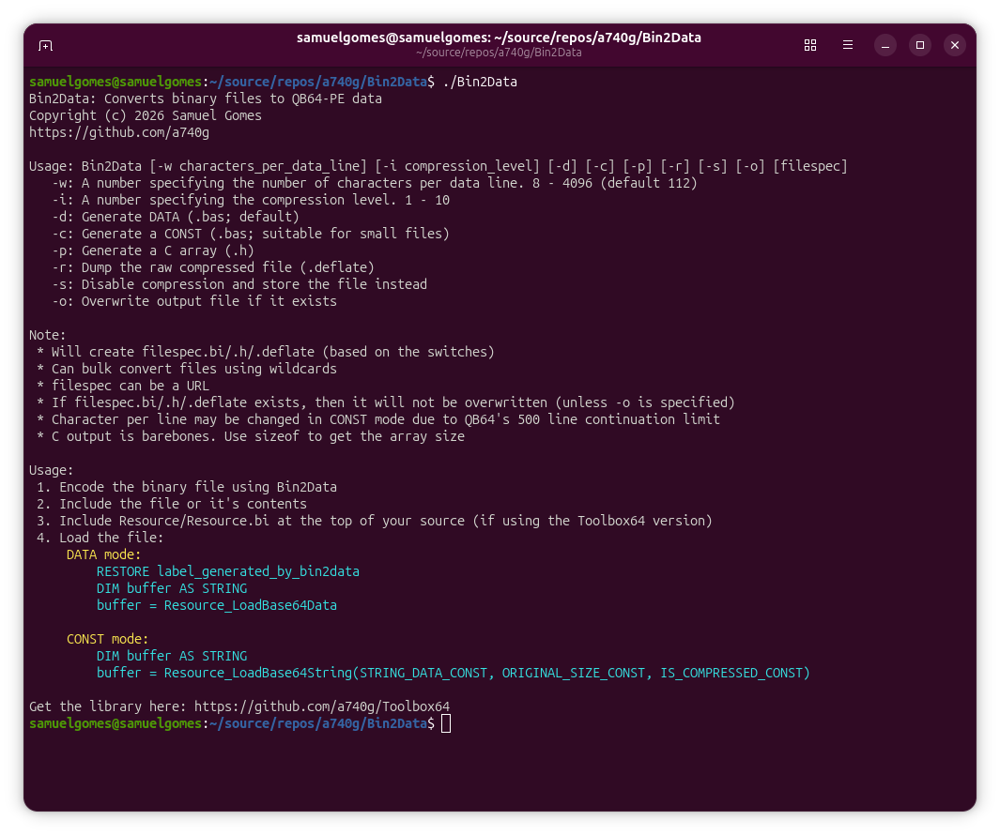

# Bin2Data

`Bin2Data` is a command-line utility, written in [QB64-PE](https://www.qb64phoenix.com), that converts binary files into source code, making it easy to embed resources directly into your executables. It also optionally compresses data using QB64-PE's native `_DEFLATE$` routine.



## Features

* Converts binary files into embeddable source code formats.
* Optionally compresses data using QB64-PE's native `_DEFLATE$` function.
* Multiple output formats supported:
  * QB64-PE `DATA` statements (`.bi` file, default).
  * QB64-PE `CONST` string (`.bi` file, suitable for smaller assets).
  * C header with a `const uint8_t` array (`.h` file) for QB64-PE `DECLARE LIBRARY`.
  * Raw Deflate/zlib compressed binary stream (`.deflate` file).
* Base64 encoding for QB64-PE `DATA` and `CONST` outputs.
* Automatic fallback to store mode if compression does not reduce file size.
* Command-line interface with wildcard and batch processing support across Windows, Linux, and macOS.
* Direct URL fetching and encoding (HTTP/HTTPS).

## Building and Running

### Prerequisites

* The latest version of [QB64-PE](https://github.com/QB64-Phoenix-Edition/QB64pe/releases).

### Method 1: Using the Makefile (Recommended)

A cross-platform [Makefile](Makefile) is included for building with GNU Make or `mingw32-make`:

```sh
# Build the application (outputs Bin2Data in the repository root)
make

# Build with C++ compiler optimizations enabled
make release

# Run the test suite
make test

# Remove build artifacts
make clean
```

### Method 2: Command-Line Compilation

Compile directly using the QB64-PE compiler:

```sh
qb64pe -x -w -e source/Bin2Data.bas -o Bin2Data
```

### Method 3: Using the QB64-PE IDE

1. Open `source/Bin2Data.bas` in the QB64-PE IDE.
2. Press `F5` to compile and run.

## Command-Line Usage

```text
Bin2Data: Converts binary files to QB64-PE data
Copyright (c) 2026 Samuel Gomes
https://github.com/a740g

Usage: Bin2Data [-w characters_per_data_line] [-i compression_level] [-d] [-c] [-p] [-r] [-s] [-o] [filespec]
   -w: A number specifying the number of characters per data line. 8 - 4096 (default 112)
   -i: A number specifying the compression level. 1 - 10
   -d: Generate DATA (.bi; default)
   -c: Generate a CONST (.bi; suitable for small files)
   -p: Generate a C array (.h)
   -r: Dump the raw compressed file (.deflate)
   -s: Disable compression and store the file instead
   -o: Overwrite output file if it exists
```

## Documentation & Code Examples

Comprehensive documentation and code listings for all use cases are available in **[docs/README.md](docs/README.md)**:

* **[QB64-PE DATA Statements (`-d`)](docs/README.md#use-case-1-qb64-pe-data-statements--d)**: Loading embedded resources using [Toolbox64](https://github.com/a740g/Toolbox64) (`Resource_LoadBase64Data`) or standalone decoder routines.
* **[QB64-PE CONST Strings (`-c`)](docs/README.md#use-case-2-qb64-pe-const-strings--c)**: Loading constant string resources with automatic line-continuation limit handling.
* **[C Header Arrays in QB64-PE (`-p`)](docs/README.md#use-case-3-c-header-arrays-in-qb64-pe--p)**: Consuming generated C headers in QB64-PE via `DECLARE LIBRARY`.
* **[Raw Deflate Dumps (`-r`)](docs/README.md#use-case-4-raw-deflate-dumps--r)**: Creating and decompressing raw deflate binary streams.
* **[Width & Compression Tuning (`-w`, `-i`, `-s`)](docs/README.md#use-case-5-custom-width-and-compression-control)**: Adjusting formatting width and compression levels.
* **[Batch & Wildcard Conversions](docs/README.md#use-case-6-batch-and-wildcard-processing)**: Batch processing asset folders.
* **[Direct URL Embedding](docs/README.md#use-case-7-remote-file-and-url-conversion)**: Downloading and embedding remote web assets.

## Assets & License

* **Project License**: Licensed under the [MIT License](LICENSE.txt).
* **Application Icon**: [Icon](https://www.iconarchive.com/artist/umut-pulat.html) by [Umut Pulat](http://12m3.deviantart.com/).
